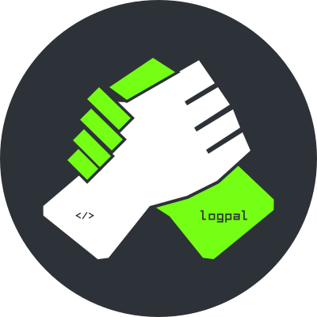

<p align="center">
  
</p>

# LogPal

LogPal creates one long-lived logging instance and one event logger per invocation. Each event collects data, warnings, errors, external calls, and completed actions and writes one structured JSON log. Sampling can reduce successful-request noise while errors and warnings use their own rates.

Inspired by https://loggingsucks.com/

Most of the project currently is "vibe-coded" to quickly get a proof of concept running, however, it has been "vibe-coded" with very specific rules and intentions in mind. Later as we progress we can improve this further if the tool actually becomes useful.

## Action-based logging

Use the `action` format for generic context and completed actions, including non-HTTP Lambda invocations. HTTP handlers can use `httpRequest` regardless of where they run.

The example is split into [examples/lambda/handler.ts](examples/lambda/handler.ts), [examples/lambda/logpal.ts](examples/lambda/logpal.ts), and [examples/lambda/operations.ts](examples/lambda/operations.ts). The `LogPal` instance is created once. Each handler invocation calls `logpal.event()` with its per-event options and callback.

```ts
import LogPal from 'log-pal';

const logpal = new LogPal({
  validateOutput: true,
  eventType: 'summary-log',
  format: 'action',
  sampling: { error: 1, warn: 1, info: 0.1 },
});

export const handler = async (event: unknown) => {
  return logpal.event(
    {
      requestId: 'request-id-from-lambda',
      shouldBypassSampling: () => true,
    },
    async () => {
      logpal.addData({
        context: { userId: 'user-id' },
      });
    },
  );
};
```

`event()` uses Node's `AsyncLocalStorage`, so helper functions can call `logpal.addData()` without passing the event through every function call. It finalizes the log when the callback completes. If the callback throws or rejects, it records an `unhandled-error`, finalizes the log, and re-throws the original error.

## HTTP Request

The HTTP format checks the request path, method, response status code, and duration. Supply all of them through `addData()`. The `format` option determines the `addData()` input type; no explicit type arguments are needed.

See [examples/httpRequest/handler.ts](examples/httpRequest/handler.ts) and [examples/httpRequest/logpal.ts](examples/httpRequest/logpal.ts) for a handler that records the request, measures the operation duration, and records the response.

```ts
const httpLog = new LogPal({
  validateOutput: true,
  eventType: 'http-request',
  format: 'httpRequest',
});

await httpLog.event({ requestId: 'trace-id' }, async () => {
  httpLog.addData({
    request: { path: '/users', method: 'GET' },
    response: { statusCode: 200, durationMs: 18 },
    custom: { userId: 'user-id' },
  });
});
```

Custom Zod object schemas are also supported. Define only the data passed through `addData()`; LogPal adds the event metadata and log collections during finalization:

```ts
import { z } from 'zod';

const accountFormat = z.object({
  account: z.object({ id: z.string() }),
  operation: z.string(),
});

const logpal = new LogPal({
  validateOutput: true,
  eventType: 'account-operation',
  format: accountFormat,
});

await logpal.event({}, async () => {
  logpal.addData({ account: { id: 'acct-1' }, operation: 'read' });
});
```

## Output

Both formats emit JSON. You must explicitly set `validateOutput` to `true` or `false` when creating a `LogPal` instance; there is no default. This is required in TypeScript and checked at runtime for JavaScript callers.

With `validateOutput: true`, LogPal validates collected data once during finalization. Missing or invalid format fields produce `_logpal.errors` with field paths and issue codes; the event is still emitted. Successful parsing applies schema defaults and transformations. Valid logs omit `_logpal`.

With `validateOutput: false`, LogPal skips schema parsing and validation diagnostics, emitting the collected data without applying schema defaults or transformations. This reduces runtime work, but incomplete context is no longer detected. TypeScript input types, action tracking, error recording, sampling, and automatic finalization still work.

When changing log fields, schemas, handlers, or helpers in ways that could omit necessary data, consider temporarily re-enabling `validateOutput: true`. Keep it enabled for a period that covers representative traffic and affected success and failure paths, inspect emitted logs for `_logpal.errors`, and fix missing or invalid data before considering disabling validation again. Validation checks only requirements expressed in the schema; require any essential application fields in a custom schema. Sampling still applies, so ensure the events being checked are emitted.

The initial API is intentionally small: `event`, `addData`, `addError`, `addWarning`, `addAction`, and `initExternalCall`. `initExternalCall` records a call immediately and returns a call handle. Finish it after the response arrives; calls that never finish remain marked as started in the finalized event log.

```ts
const logpalExternalCall = logpal.initExternalCall({
  url: 'https://service.example.com',
  method: 'POST',
});

const response = await fetch('https://service.example.com', { method: 'POST' });
logpalExternalCall.finish({
  statusCode: response.status,
  custom: { retried: false },
});
```

Record completed actions inside an event with `addAction()`. Each action gets a number starting at 1 for that event and a UTC ISO 8601 timestamp captured when it is added. Actions remain in insertion order and are included even if the handler later fails.

```ts
logpal.addAction({
  name: 'Account updated',
  custom: { accountId: 'acct-1' },
});
```

The event's `actions` array includes:

```json
[
  {
    "name": "Account updated",
    "custom": { "accountId": "acct-1" },
    "number": 1,
    "timestamp": "2026-11-17T12:00:00.000Z"
  }
]
```

## Sampling

Sampling uses the event's final log level and its configured rate. When `requestId` is provided, LogPal derives a stable sampling value from that ID. Propagate the same `requestId` and use the same rate across services to keep or drop the whole request chain consistently. Different log levels or configured rates can produce different decisions for the same ID.

Without a `requestId`, each event uses `Math.random()`. Errors always bypass sampling, and `shouldBypassSampling` can also keep selected non-error events. Rates of `0` drop non-bypassed events; rates of `1` keep them.

## Agent skill

The package includes a [LogPal skill](skills/logpal/SKILL.md) for agents adding or changing application logging. After installing `log-pal`, the skill is available at `node_modules/log-pal/skills/logpal/SKILL.md`.

## "Thinking aloud"

What should logs actually contain? Shouldn't external calls be tracked separately and not in logs? Logs should contain only errors?
(TODO: Consider above thought)

What if I could prepare a "tester" (that could be run on CI level also for example) that would go through the code and check whether there is some branching done that could result in required data to never be added to the log? This could actually be pretty straightforward, because I could do some branching (conditions) checking by traversing typescript code...
(TODO: Consider above thought)
